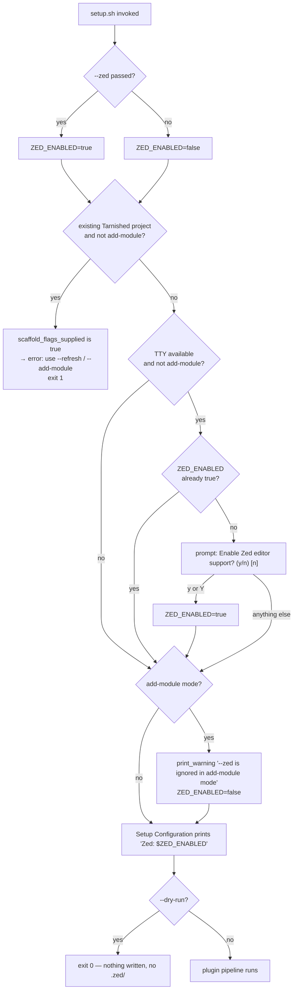
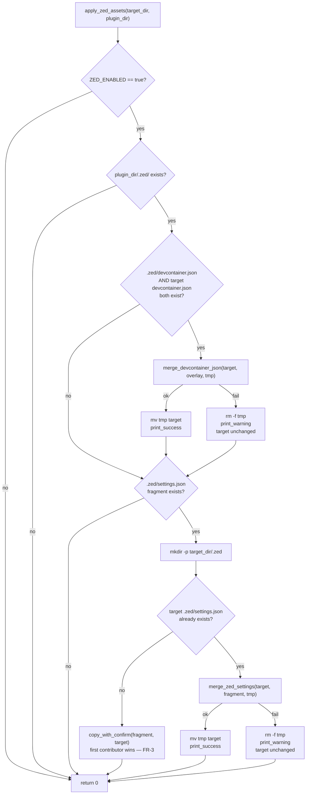
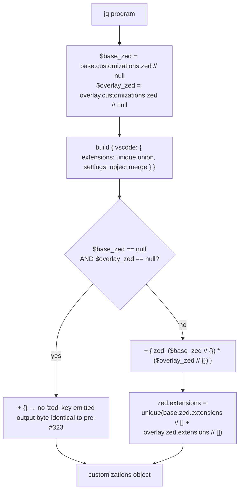

# Flowchart: #323 Optional Zed editor support

## `ZED_ENABLED` resolution

Where the single boolean comes from, and the two places it is forced back off.

## `apply_zed_assets <target_dir> <plugin_dir>`

Called once per participating plugin. Both guards at the top are what make the
non-`--zed` path a pure no-op, and both failure branches leave the live file
exactly as it was.

## `merge_devcontainer_json` — `customizations.zed` emission

The decision that carries NFR-1. The `vscode` subtree is built exactly as
before, in every branch.

