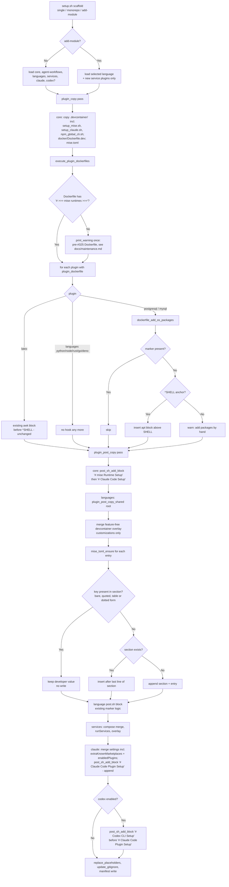
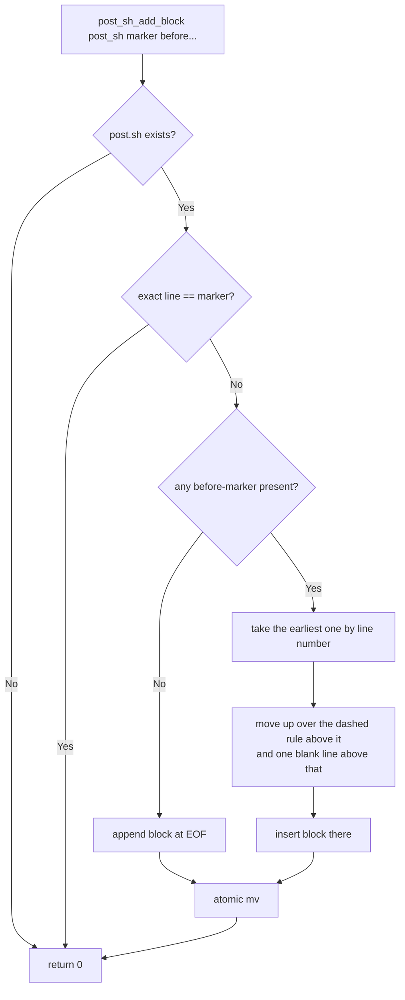

# Flowchart: #325 Replace devcontainer features with mise runtimes, Dockerfile OS packages, and post.sh AI CLI installs

Scaffold-time decisions made by `setup.sh` and the plugins. The build-time and
post-create flows are system-wide and live in
[`../shared/sequence.md`](../shared/sequence.md) ("Container build and
post-create").

## Scaffold pipeline

## `post_sh_add_block` placement

Resulting order for a default `--codex` scaffold:
`# Tarnished Asset Refresh` → `# mise Runtime Setup` → `# Claude Code Setup`
→ language/service blocks → `# Codex CLI Setup` → `# Claude Code Plugin Setup`.
