# Flowchart: #331 Add Godot (GDScript + C#) language flavor with WSLg GUI overlay and headless CI

Issue-local decision logic. The system-wide part (Compose applying the
overlay at container start, and the `post.sh` order) is in
[`../shared/sequence.md`](../shared/sequence.md), section "Godot flavor: GUI
opt-in and container launch".

## Scaffold: godot plugin hooks

```mermaid
graph TD
    A[setup.sh selects godot<br/>--lang / --module x:godot / --add-module x --lang godot] --> C1

    subgraph copy[plugin_copy root]
        C1{godot-quality-check.yml<br/>exists?} -->|No| C2[copy workflow]
        C1 -->|Yes| C3{TTY and answer y?}
        C3 -->|Yes| C2
        C3 -->|No| C4[skip workflow]
        C2 --> C5[copy_with_confirm<br/>docker-compose.godot-gui.yml]
        C4 --> C5
    end

    C5 --> D1

    subgraph dockerfile[plugin_dockerfile]
        D1{'# >>> godot os-packages >>>'<br/>present?} -->|Yes| D4[skip]
        D1 -->|No| D2{SHELL anchor?}
        D2 -->|Yes| D3[insert apt block above SHELL]
        D2 -->|No| D5[warn: add packages by hand]
    end

    D3 --> P0
    D4 --> P0
    D5 --> P0

    P0[post-copy pass: source plugin.sh<br/>GODOT_GUI_ENABLED=empty] --> P1{setup.sh: TTY available?}
    P1 -->|Yes| H1
    P1 -->|No: hook not called| S1

    subgraph interactive[plugin_interactive_setup - TTY only]
        H1[_godot_resolve_gui_choice] --> H2{choice still empty?}
        H2 -->|No| H5[keep resolved value]
        H2 -->|Yes| H3["prompt: Enable the Godot GUI editor<br/>through WSLg? default y iff /mnt/wslg and /dev/dxg"]
        H3 -->|y| H4[GODOT_GUI_ENABLED=true]
        H3 -->|n| H6[GODOT_GUI_ENABLED=false]
    end

    H4 --> S1
    H5 --> S1
    H6 --> S1

    subgraph resolver[_godot_resolve_gui_choice - never prompts]
        R1{GODOT_GUI set?} -->|true/1/yes| RE[true]
        R1 -->|other value| RD[false]
        R1 -->|unset| R2{overlay already listed<br/>in dockerComposeFile?}
        R2 -->|Yes| RE
        R2 -->|No| R3{UPGRADE / CREATE_MANIFEST /<br/>-y / no TTY?}
        R3 -->|Yes| RD
        R3 -->|No| RO[leave empty]
    end

    H1 -.->|calls| R1
    S6b -.->|calls| R1

    subgraph shared[plugin_post_copy_shared root]
        S1{tools.godot present?<br/>mise_toml_has_key} -->|Yes| S1k[keep; no alias]
        S1 -->|No| S1w[ensure tool_alias.godot<br/>then tools.godot]
        S1k --> S2[ensure tools.dotnet, tools.uv]
        S1w --> S2
        S2 --> S3{tools.gdtoolkit present?}
        S3 -->|Yes| S3k[keep; no alias]
        S3 -->|No| S3w[ensure tool_alias.gdtoolkit<br/>then tools.gdtoolkit]
        S3k --> S4[ensure env DOTNET_CLI_TELEMETRY_OPTOUT,<br/>DOTNET_NOLOGO]
        S3w --> S4
        S4 --> S5[merge devcontainer customizations]
        S5 --> S6[apply_zed_assets<br/>no-op without --zed]
        S6 --> S6a{GODOT_GUI_ENABLED empty?}
        S6a -->|Yes: non-TTY run| S6b[_godot_resolve_gui_choice root]
        S6a -->|No| S7
        S6b --> S7{GODOT_GUI_ENABLED == true?<br/>empty counts as false}
        S7 -->|No| S9
        S7 -->|Yes| G1{overlay file and<br/>devcontainer.json exist?}
        G1 -->|No| G2[warn + manual hint]
        G1 -->|Yes| G3{entry present?}
        G3 -->|Yes| G4[info: already enabled]
        G3 -->|No| G5{jq append ok?}
        G5 -->|Yes| G6[mv: dockerComposeFile +=<br/>../docker-compose.godot-gui.yml]
        G5 -->|No| G2
        G2 --> S9
        G4 --> S9
        G6 --> S9
        S9[merge Claude hooks] --> S10[copy_dir_with_confirm rules]
        S10 --> S11{gitignore marker<br/>exact line present?}
        S11 -->|No| S12[append Godot block]
        S11 -->|Yes| S13
        S12 --> S13{'# Godot Engine Setup'<br/>in post.sh?}
        S13 -->|Yes| S16[skip]
        S13 -->|No| S14{Codex or plugin<br/>marker present?}
        S14 -->|Yes| S15a[insert before earliest]
        S14 -->|No| S15b[append]
    end

    S15a --> M1
    S15b --> M1
    S16 --> M1

    subgraph module[plugin_post_copy_module dir]
        M1[copy_with_confirm gdlintrc] --> M2[copy_with_confirm .editorconfig]
    end

    M2 --> R[setup.sh: replace_placeholders<br/>renders overlay service key]
```

## CI: `godot-quality-check.yml` skip logic

```mermaid
graph TD
    subgraph lint[job lint]
        L1{any *.gd outside<br/>.godot/ and addons/?} -->|No| L0[notice + success]
        L1 -->|Yes| L2[mise-action: uv gdtoolkit] --> L3[gdlint files] --> L4[gdformat --check files]
    end

    subgraph test[job test]
        T1{any project.godot?} -->|No| T0[notice + success]
        T1 -->|Yes| T2[mise-action: godot dotnet] --> T3[for each project dir]
        T3 --> T4{*.csproj?}
        T4 -->|Yes| T5[dotnet build]
        T4 -->|No| T6
        T5 --> T6{addons/gut?}
        T6 -->|No| T7[notice: skip GUT]
        T6 -->|Yes| T8{.gutconfig.json or<br/>test/ or tests/?}
        T8 -->|No| T9[notice: skip GUT]
        T8 -->|Yes| T10[godot --headless --import] --> T11[GUT -gexit]
    end

    subgraph export[job export]
        E1{any export_presets.cfg<br/>next to project.godot?} -->|No| E0[notice + success]
        E1 -->|Yes| E2[mise-action: godot dotnet] --> E3[derive tag + template dir]
        E3 --> E4{templates cached?}
        E4 -->|No| E5[download tpz + SHA512-SUMS<br/>verify, unzip]
        E4 -->|Yes| E6
        E5 --> E6[for each preset]
        E6 --> E7{export_path set?}
        E7 -->|No| E8[notice: skip preset]
        E7 -->|Yes| E9[godot --headless --export-release<br/>name build/ci-export/n/basename]
    end
```

