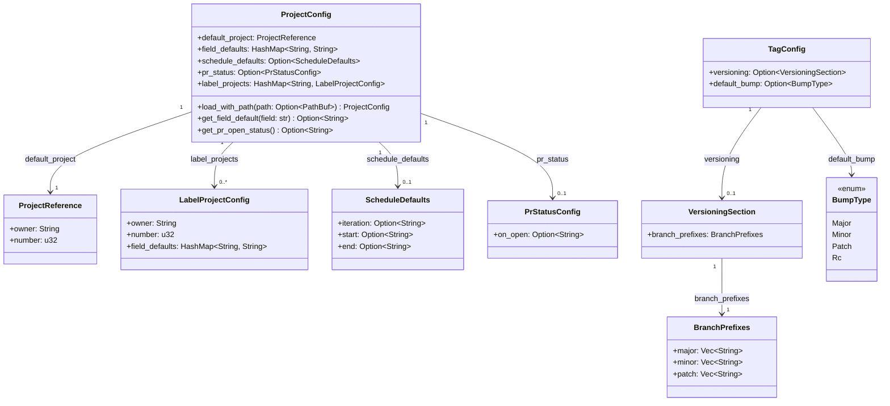
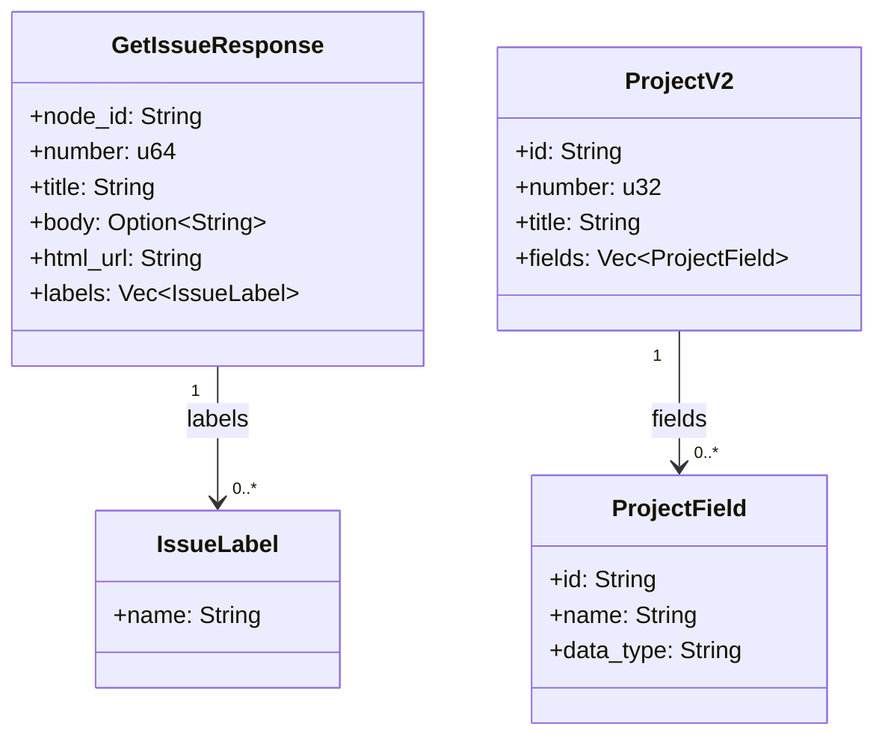
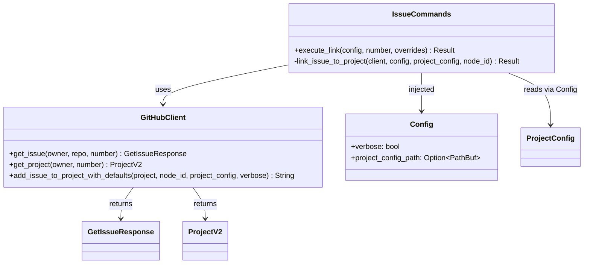
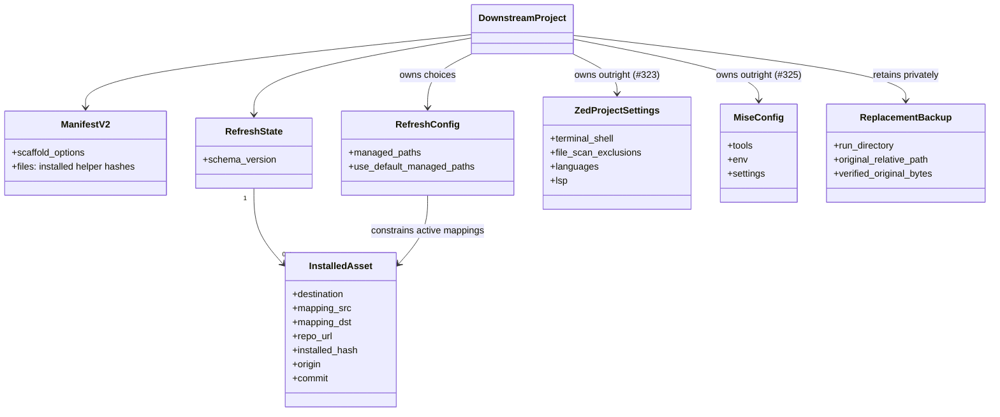
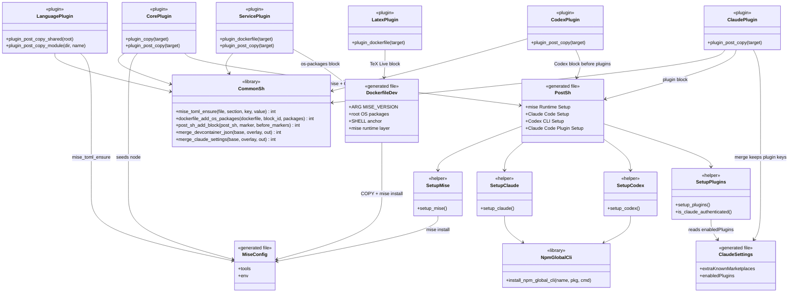

# Class Diagram (Project-wide)

Cumulative class/type diagram for the Rust CLI, shell maintenance metadata, and the generated install contract. Snapshot — overwritten on every `/design` (NFR-1).

## Configuration types

## GitHub types

## CLI command + clients

## Foundation ownership metadata

## Generated install contract (#325)

Shell-side structure of the three install layers. "Classes" are files; methods
are their entry functions. Arrows read "uses" unless labelled. File mapping:
`CommonSh` = `scripts/lib/common.sh`; `CorePlugin`/`ClaudePlugin`/`CodexPlugin`
= `templates/{core,claude,codex}/plugin.sh`; `LanguagePlugin` =
`templates/languages/{python,node,rust,go,deno}/plugin.sh`; `LatexPlugin` =
`templates/languages/latex/plugin.sh`; `ServicePlugin` =
`templates/services/{postgresql,mysql}/plugin.sh`; `DockerfileDev`,
`MiseConfig`, `PostSh`, `ClaudeSettings` = the generated
`docker/Dockerfile.dev`, `mise.toml`, `.devcontainer/scripts/post.sh`,
`.claude/settings.json`; `Setup*` / `NpmGlobalCli` = the
`.devcontainer/scripts/*.sh` helpers of the same names.

## Notes

- `LabelProjectConfig` keys (in `ProjectConfig.label_projects`) are issue-label names; values are independent project + field defaults (#230).
- `BranchPrefixes` is the canonical internal struct; `VersioningSection` (Format B) deserializes directly into it, while a custom deserializer collapses Format A (`branches: [{prefix, bump}]`) into the same shape (#228).
- `BumpType::Rc` is the default when no branch prefix matches.
- `IssueCommands::link_issue_to_project` accepts a `ProjectConfig` so it can be reused for both default and label-routed links (#230 refactor).
- `MiseConfig` (`<project>/mise.toml`, #325) has the same ownership shape as `ZedProjectSettings`: seeded at scaffold time (core template + `mise_toml_ensure` entries) and then developer-owned, with no edge to `ManifestV2`, `RefreshConfig` or `RefreshState`. The helper scripts that consume it (`setup_mise.sh` etc.) *are* manifest-eligible; the file they read is not.
- In the install-contract diagram, `npm_global_cli.sh` is a library sourced by two entry helpers, not a `post.sh` entry itself; `post.sh` order (mise → Claude Code → Codex → plugins) is enforced by `post_sh_add_block`, not by plugin load order.
- `ZedProjectSettings` (`<project>/.zed/settings.json`, #323) is drawn as a direct child of `DownstreamProject` with no edge to `ManifestV2`, `RefreshConfig` or `RefreshState`: it is written once at scaffold time by `apply_zed_assets` and then wholly developer-owned — not an AI asset (no `refresh.json` mapping) and outside `_manifest_path_eligible`, so no maintenance path reads, rewrites or prunes it. The absence of those edges is the ownership statement.
