# Sequence Diagram (System-wide)

Cumulative system-wide flows. Each `##` section is a named flow. Snapshot — regenerated on every `/design` (NFR-1).

## `erd issue link` — default + label routing (#230)

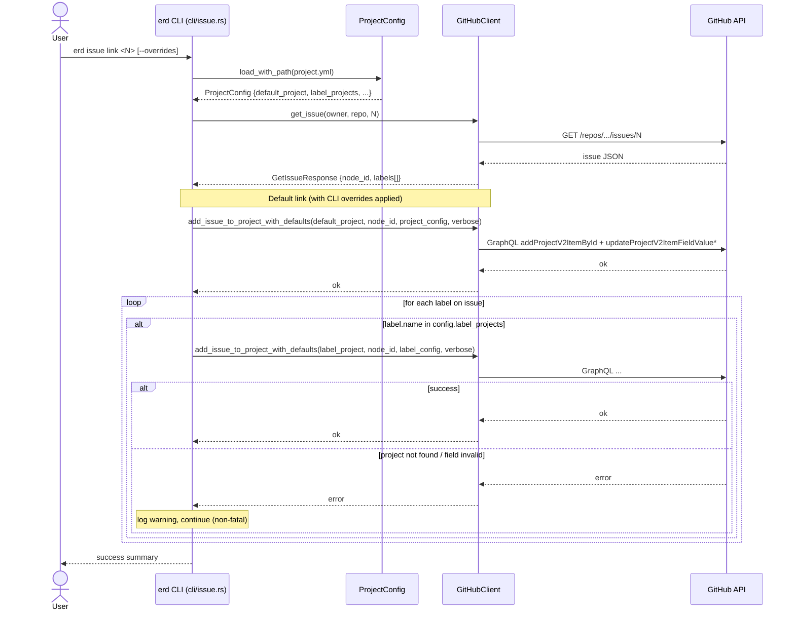

## Tag bump computation from branch prefix (#228)

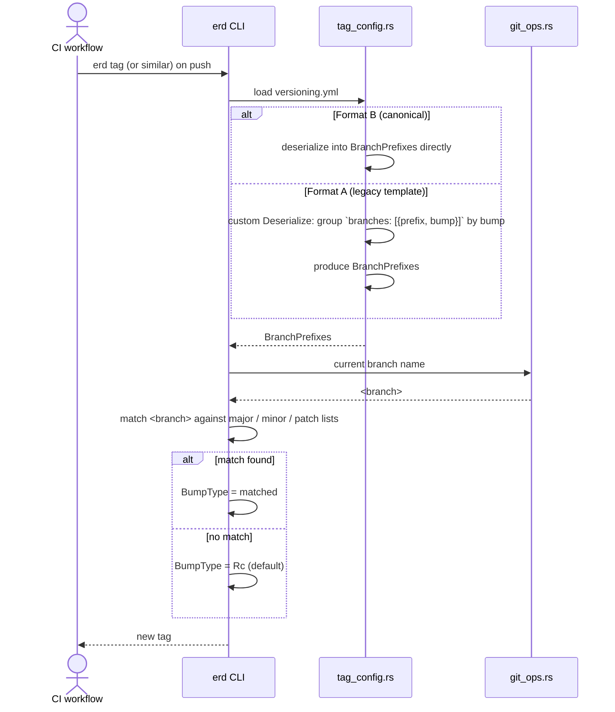

## Container build and post-create (#325)

The generated environment installs in three layers: OS packages at image build
(root), runtimes from `mise.toml` at image build (`vscode`), and AI CLIs plus
Claude plugins in `post.sh`. No devcontainer `features` are involved, so a
plain `docker build` of `docker/Dockerfile.dev` yields the same runtimes as a
devcontainer build. `post.sh` runs under `set -e`; every helper returns 0.

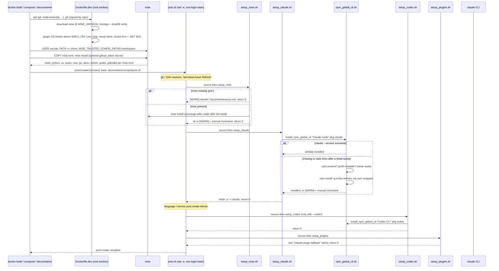

Order is load-bearing: a Node change in `mise.toml` installs a new Node in
`setup_mise`, which drops npm globals, so `setup_claude` and `setup_codex`
must run after it and before `setup_plugins` needs `claude`.

## Godot flavor: GUI opt-in and container launch (#331)

Two moments carry the system-wide part of the godot flavor:

1. **Scaffold.** Recording the opt-in.
2. **Container start.** Compose applies the separate WSLg overlay only when
   `devcontainer.json` lists it.

Headless is the default on every host, so a non-WSLg host never sees
`/dev/dxg`. Plugin-internal branching is in `docs/design/#331/flowchart.md`.

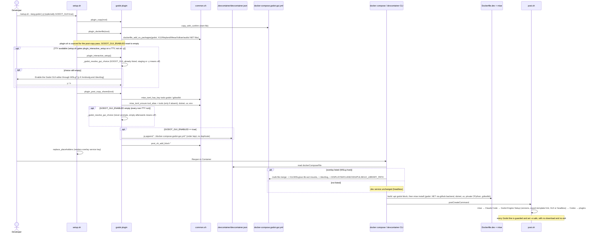

Turning the GUI off for one host means deleting the `dockerComposeFile`
entry and rebuilding. The overlay file itself stays in the project.

## Claude plugin fallback (`setup_plugins`, #249, #255, #273, #325)

`.claude/settings.json` declares the plugin set (`extraKnownMarketplaces`,
`enabledPlugins`). Claude Code does not download external plugins on a new
machine by itself, so the fallback installs enabled ids that are missing.

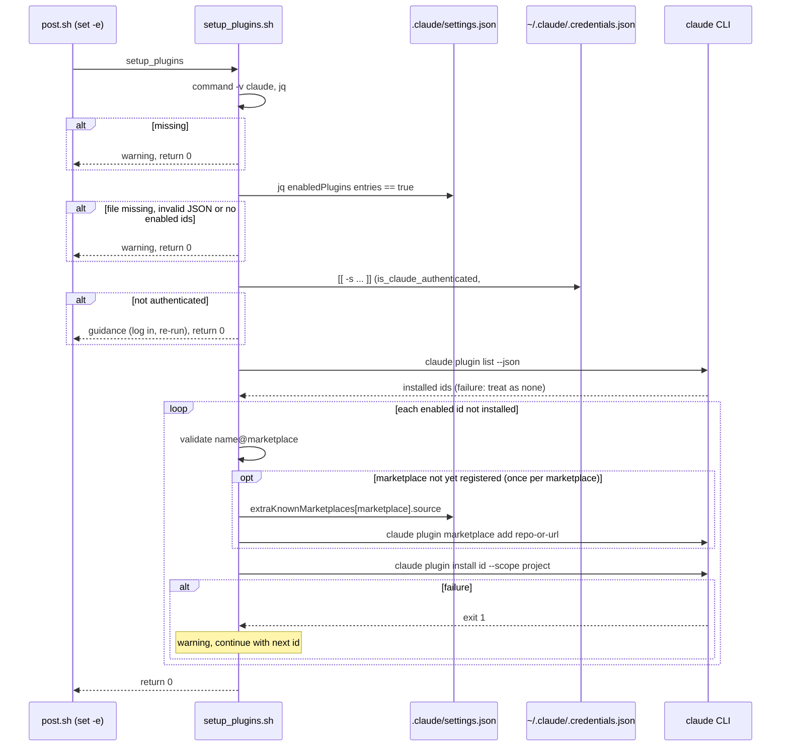

The workspace and template copies of `setup_plugins.sh` are byte-identical
(`verify-mirrors.sh`).

## Claude Code skill workflow (`/issue` → `/design` → `/implement` → `/review` → `/pr`)

Role ownership per stage follows the #312 restructure: the orchestrator **is** the session, authoring is delegated to `designer` and `executor`, and the orchestrator reviews each delegated artifact before it is committed.

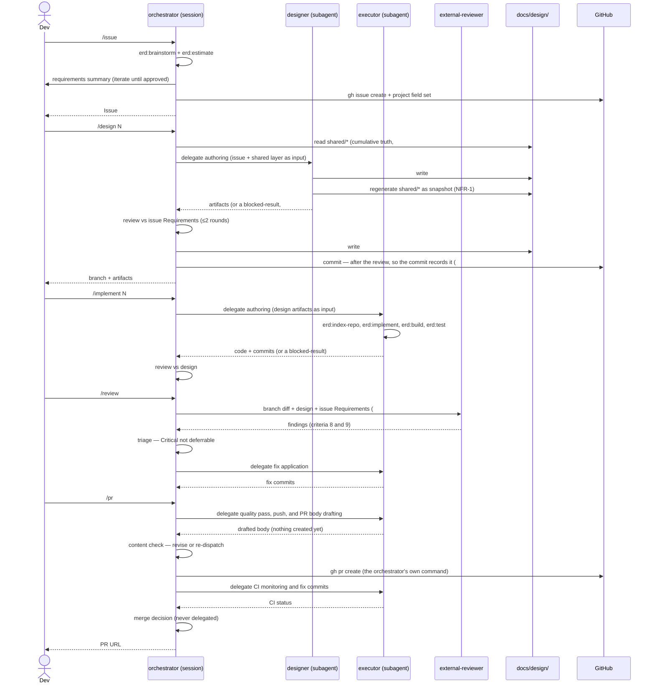

Under `/flow` the same sequence runs in one pass with **no approval gates** (#312). The two human confirmations that formerly sat before `design` and before `implement` are gone, because the party that reviews each artifact is now the session itself rather than a subagent that cannot reach the user. A run stops for the user in exactly four places: requirement gathering, an escalation the orchestrator cannot resolve (a subagent blocked-result, or a blocking review finding surviving two rounds), argument resolution, and a `/pr` failure.

## Design-artifact migration (one-shot, #257)

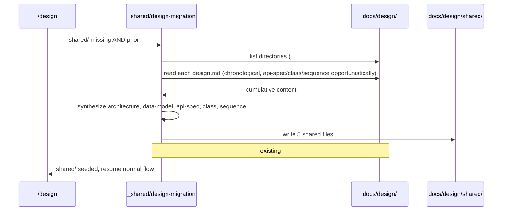

## Codex CLI: install in devcontainer + `/review` execution (#261)

Two phases: (a) `setup_codex` runs during devcontainer post-create to make `codex` available on `$PATH`; (b) every subsequent `/review` invocation streams a prompt to `codex exec` and captures the result. Phase (a) is system-wide for any project that ships `setup_codex.sh` (workspace + downstream Codex-flavor projects); since #325 it delegates to the shared `npm_global_cli.sh::install_npm_global_cli` (detailed in "Container build and post-create" above) and runs after `setup_claude`, before `setup_plugins`. The sudo decision tree of `docs/design/#261/flowchart.md` no longer applies: the helper never uses sudo.

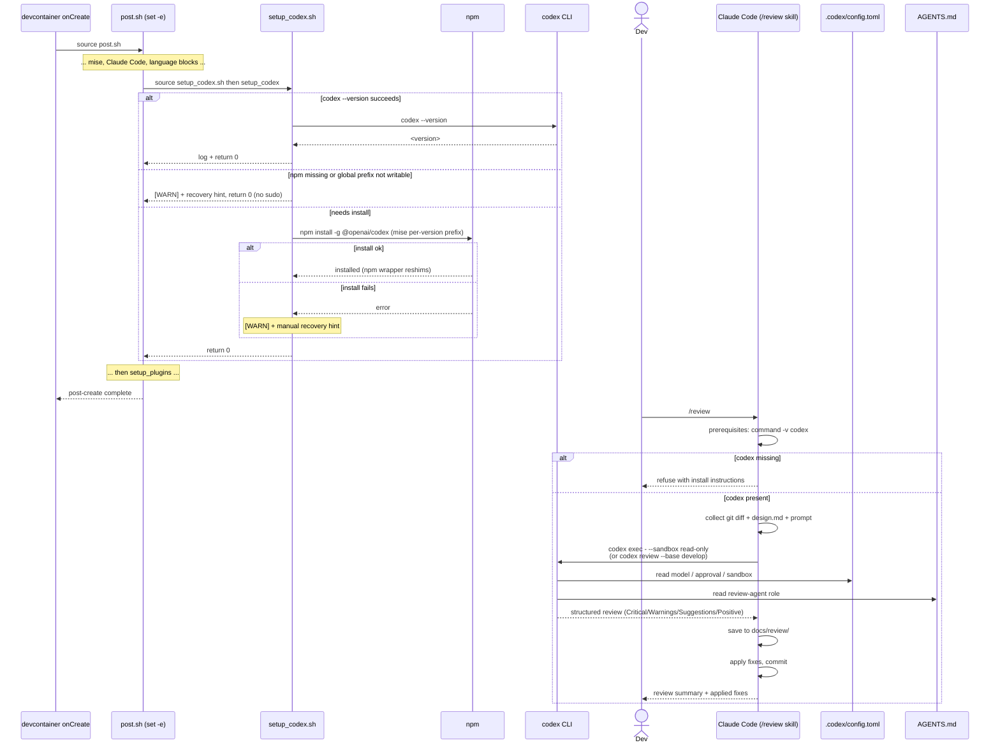

## `update_gitignore` — block-level idempotent appends (#259)

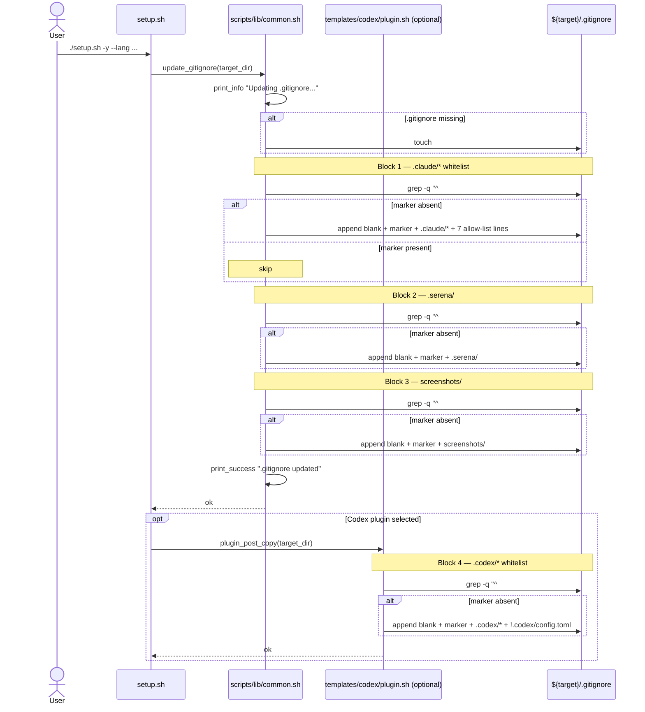

## `setup.sh --monorepo` — one-shot monorepo init (#263)

Runs against an empty target directory. Generates root assets + per-module sub-directories + `modules.json`. The mode-selection portion of `main()` is captured separately in `docs/design/#263/flowchart.md`; this sequence focuses on the post-copy dispatch.

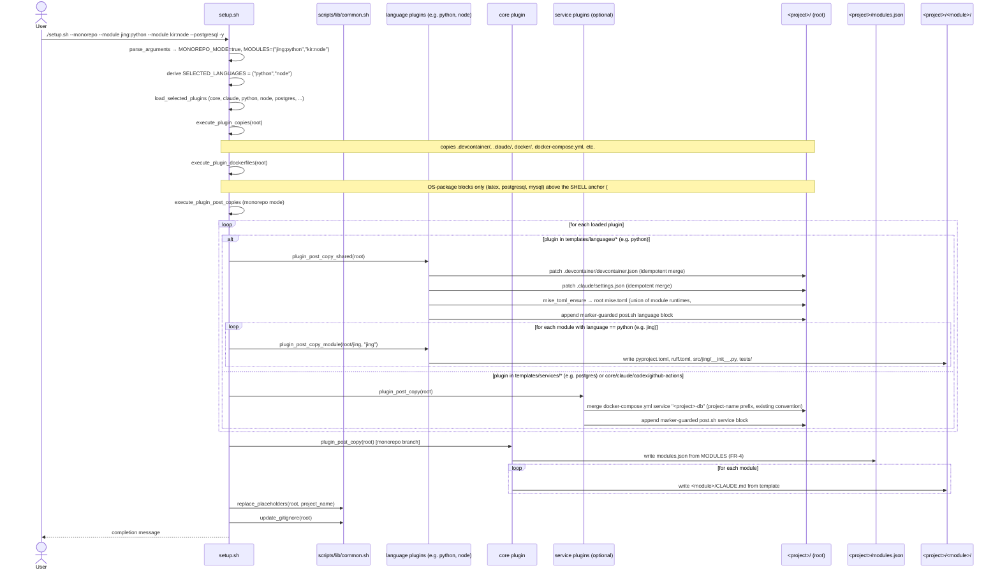

## Setup ownership bootstrap and runtime-helper upgrade

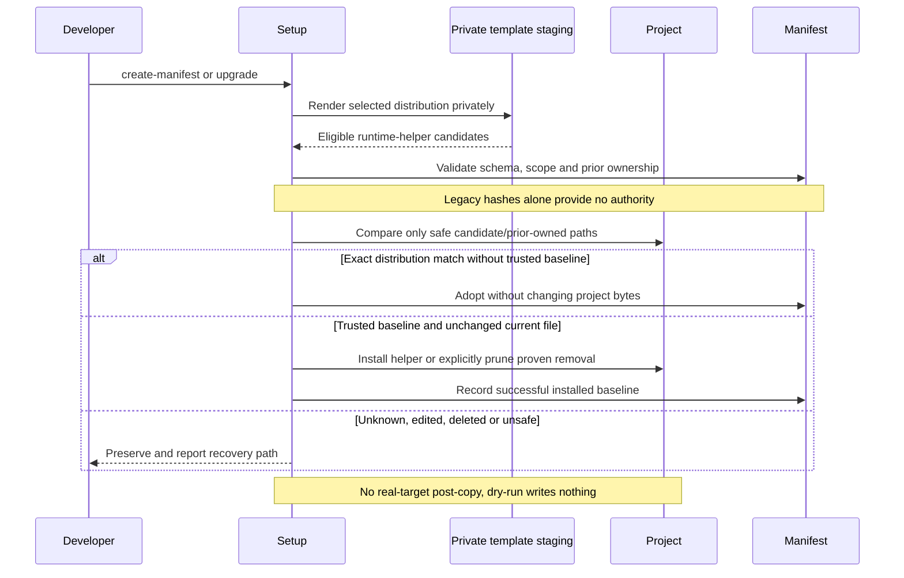

## `setup.sh` remote bootstrap (`curl | bash`) (#276)

The primary distribution path. The bootstrap block at `setup.sh:29-69` detects pipe execution, clones the upstream repo into a temp dir, then `exec`s the local copy. The `< /dev/null` on the `exec` line is what keeps the outer curl from emitting a spurious `curl: (23)` to the user terminal.

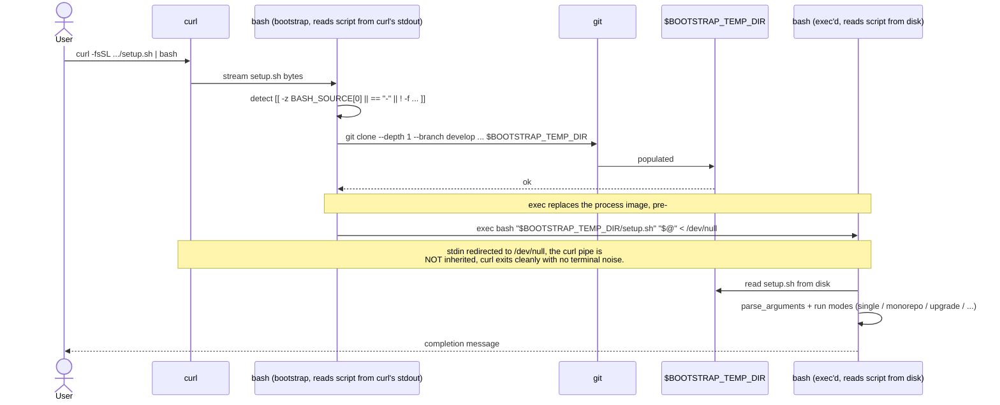

## GitHub Project Integration — auto-detection and fallback (#276)

`plugin_interactive_setup` (in `templates/github-actions/project-integration/plugin.sh`) attempts `gh` CLI auto-detection of GitHub Projects and falls back to manual prompts on failure. Pre-#276 the fallback could be skipped when `gh` failed under `set -e`; post-#276 every gh invocation goes through `_gh_run`, which always returns 0 and writes the first line of gh's stderr to `GH_LAST_ERROR_FILE_FILE` (a process-wide `mktemp`'d path) so the parent shell can surface it after the `$(...)` subshell returns.

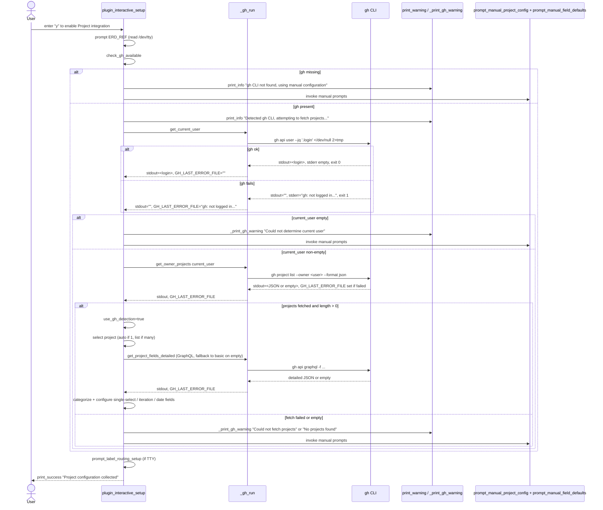

## Continuous AI asset refresh with backups

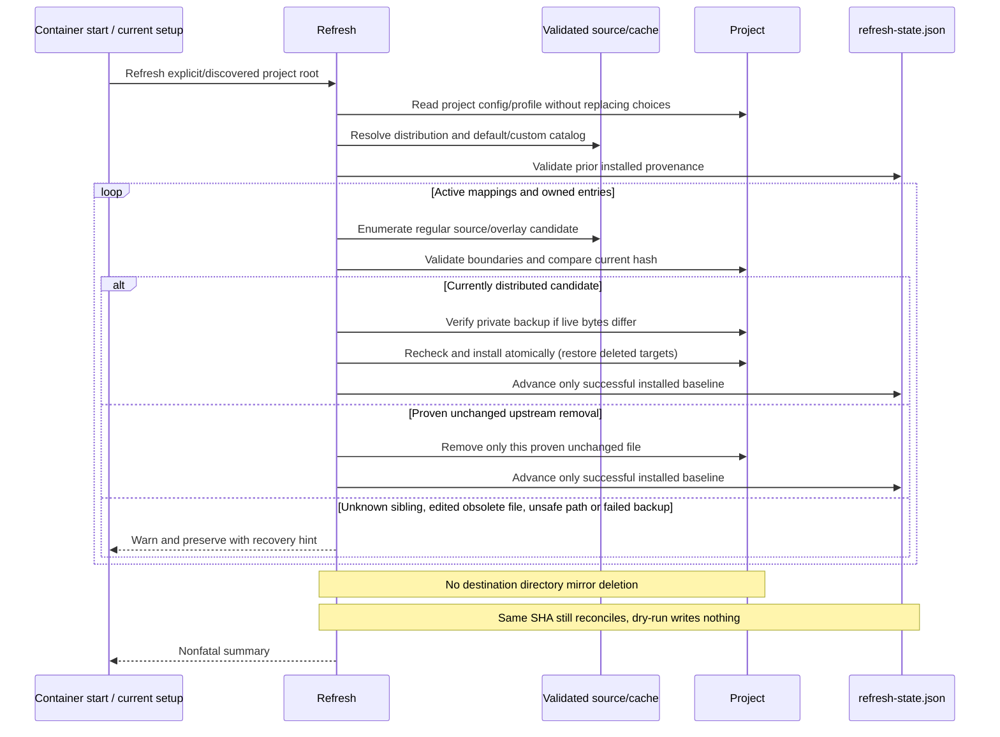

Current setup bypasses an old installed updater. Proven unchanged legacy helpers migrate automatically from shipped-content evidence; unproven/edited helpers receive explicit migration guidance. Explicit add-module remains a scaffold extension, not automatic rerun behavior.

## `setup.sh --add-module` — incremental add to existing monorepo (#263)

Detects an existing `modules.json` in CWD (or accepts `--add-module` flag) and adds a single module. Idempotent against shared assets via marker-guarded blocks and JSON merge helpers.

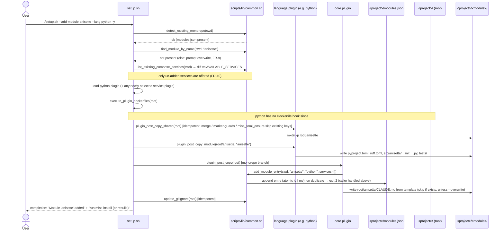

## `setup.sh --zed` — optional Zed editor assets (#323)

Additive editor flavor. One global (`ZED_ENABLED`) and one shared helper
(`common.sh::apply_zed_assets`) carry all four artifact groups;
`customizations.vscode` is always kept, so the generated project opens in
either editor. Without `--zed` every `apply_zed_assets` call returns at its
first guard and `merge_devcontainer_json` emits no `zed` key, so the generated
tree is byte-identical to a pre-#323 run. The helper's internal branching is
in `docs/design/#323/flowchart.md`.

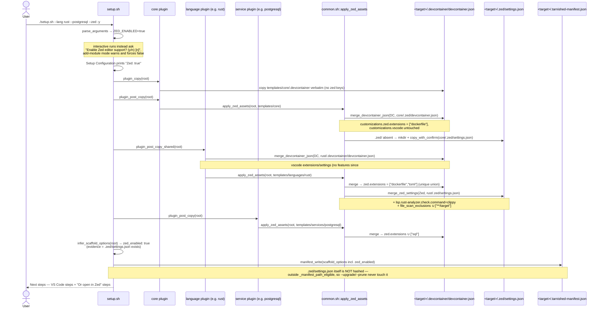

A merge failure on either file is non-fatal: the helper removes its temp file,
emits `print_warning` and leaves the live file untouched, then returns 0.

## Devcontainer JSON merge with comment normalization

Language and service plugins call `merge_devcontainer_json` to merge VS Code
extensions, VS Code settings, and — when either side declares it (#323) — the
`customizations.zed` subtree. Since #325 no shipped overlay carries
`features`; other top-level keys (including a developer's own `features`) are
deep-merged and emitted only when present. The helper
accepts strict JSON or comment-bearing devcontainer JSON, normalizes comments
away in private temp files, and then runs the structural `jq` merge. The output
is strict JSON.

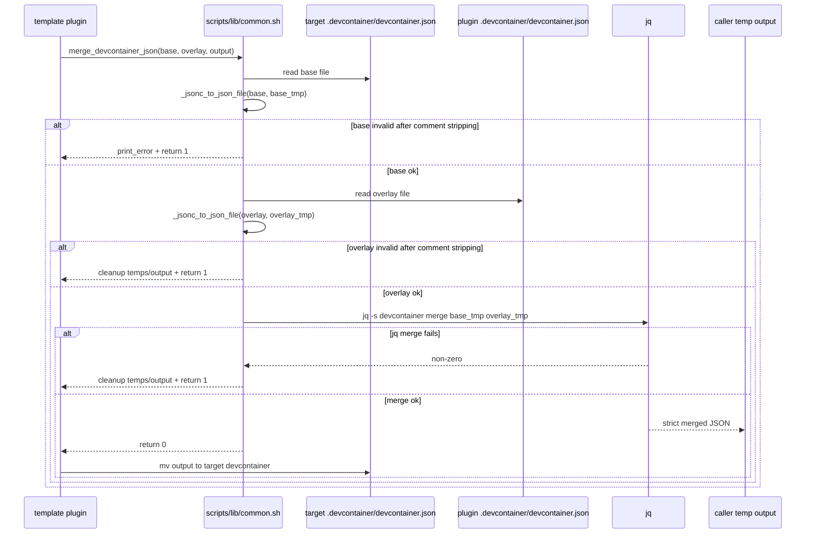
